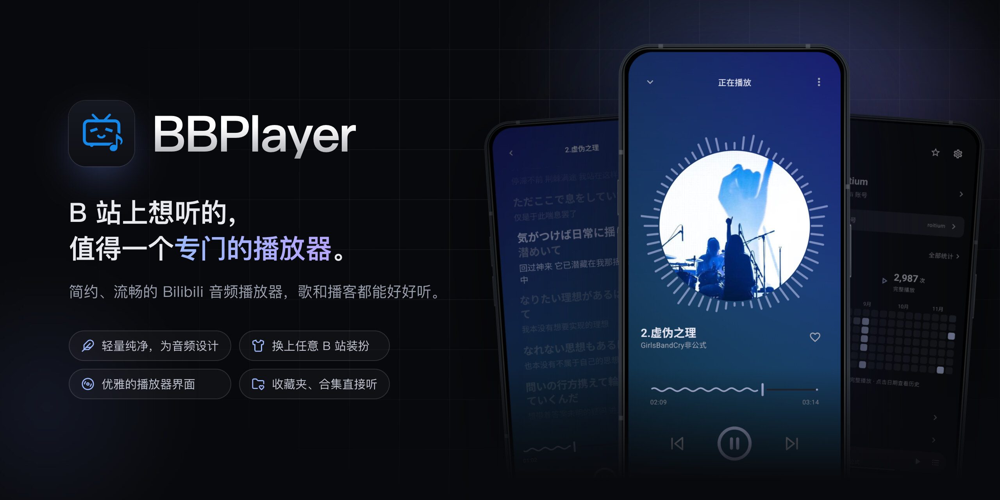
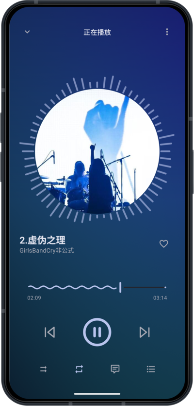
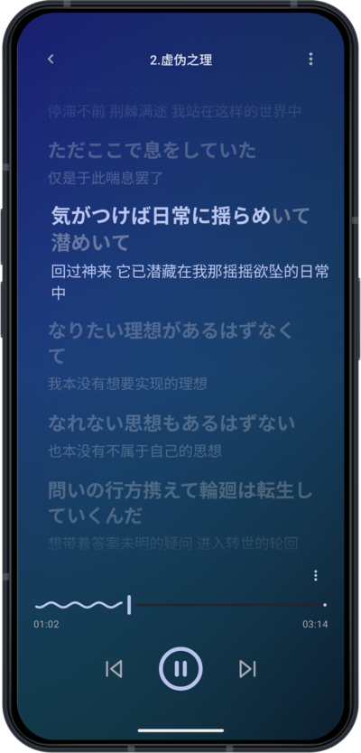
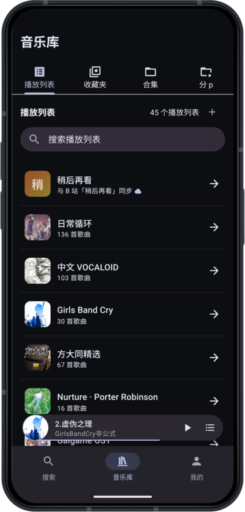
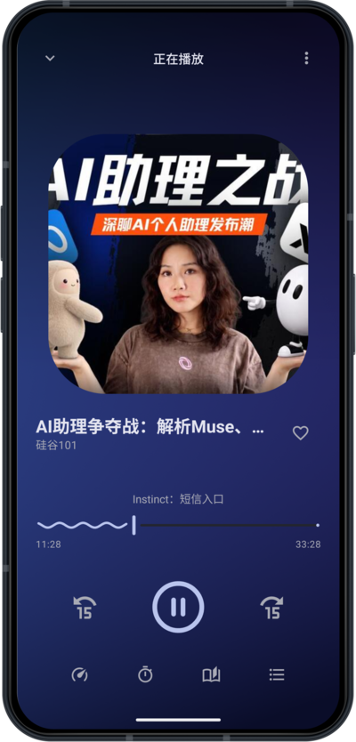
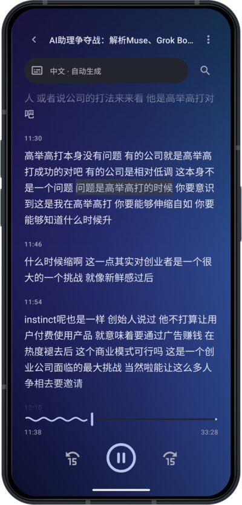
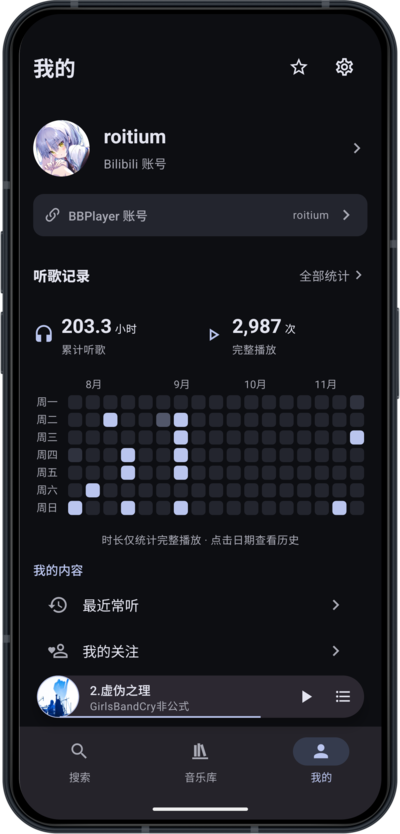
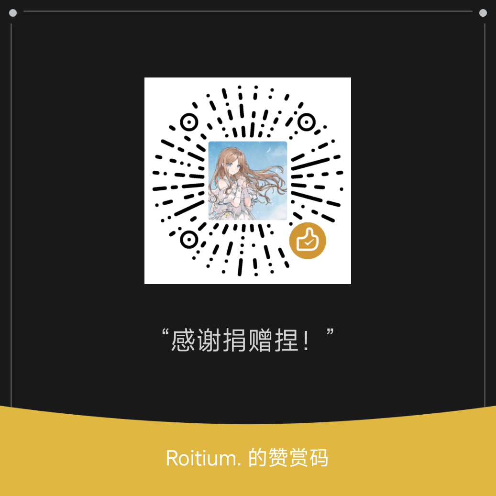

<div align="center">



<h1>BBPlayer</h1>

**B 站上想听的，值得一个专门的播放器。**

[](https://github.com/bbplayer-app/BBPlayer/releases/latest)
[](https://github.com/bbplayer-app/BBPlayer/releases)
[](#下载)
[](./LICENSE)
[](https://github.com/bbplayer-app/BBPlayer/stargazers)

[](https://github.com/bbplayer-app/BBPlayer/releases/latest)
[](https://bbplayer.roitium.com/guides/)

[官网](https://bbplayer.roitium.com) · [使用指南](https://bbplayer.roitium.com/guides/) · [更新日志](https://github.com/bbplayer-app/BBPlayer/releases) · [问题反馈](https://github.com/bbplayer-app/BBPlayer/issues)

</div>

## 截图

<p align="center">
  
  
  
  
  
  
</p>

<p align="center"><sub>播放器 · 逐字歌词 · 音乐库 · 播客 · 字幕阅读 · 听歌记录</sub></p>

## 功能

### 听歌

- **逐字歌词**：自动从网易云音乐、QQ 音乐、酷狗匹配歌词，支持逐字进度、翻译与罗马音；对不上时可以手动搜索、编辑或调整时间轴。歌词格式基于 [SPL 规范](https://bbplayer.roitium.com/SPL/)。
- **系统级歌词**：桌面悬浮歌词、状态栏歌词（词幕 Lyricon、SuperLyric、魅族 Flyme）和车载歌词。
- **会变色的播放器**：从封面提取主题色，背景是流动的渐变；可选波浪进度条和封面周围的实时音频频谱。
- **完整的播放控制**：随机、循环、播放队列、定时关闭、响度均衡、启动时恢复进度。

### 播客

- **断点续播**：每段音频单独记住播放进度。
- **为长内容准备的控制**：快退快进 15 秒、倍速、定时关闭、章节列表。
- **字幕跟读**：B 站字幕随播放定位并高亮当前句子，可以搜索关键词、点句跳转、导出 LRC。

### 音乐库

- **多种来源**：B 站收藏夹、订阅合集、稍后再看、关注的 UP 主投稿和分 P 视频都能直接浏览播放。
- **一键同步到本地**：值得留下的内容同步成本地歌单，自由改名、拖动排序、批量整理，也能反向同步到 B 站。
- **导入外部歌单**：粘贴网易云音乐或 QQ 音乐歌单链接，自动在 B 站匹配对应曲目。
- **链接直达**：搜索框直接识别 BV / AV 号、b23.tv 短链和完整视频链接。
- **共享歌单**：一条链接邀请朋友订阅或一起编辑。

### 离线与数据

- **下载与导出**：整个歌单一键缓存，离线播放；Android 可导出带封面、元数据和歌词的 `.m4a` 文件。
- **听歌记录**：听歌热力图、每日历史与播放排行，只保存在本地。
- **备份**：导出 `.bbplayer` 备份文件，或直接备份到自己的 WebDAV。

### 个性化

- **B 站装扮**：搜索并下载 B 站主题装扮和收藏集，换上对应的标题栏、进度滑块、点赞动画、头像框和开屏动画。
- **Material Design 3**：浅色 / 深色模式，墨水屏可用的纯白背景，平板上使用侧边导航和双栏布局。

更多功能和使用方法请看[使用指南](https://bbplayer.roitium.com/guides/)。

## 下载

前往 [GitHub Releases](https://github.com/bbplayer-app/BBPlayer/releases/latest) 下载 APK，需要 **Android 8.0** 及以上：

| 安装包           | 适用设备                             |
| ---------------- | ------------------------------------ |
| `arm64-v8a`      | 绝大多数近几年的手机，不确定就选这个 |
| `armeabi-v7a`    | 较老的 32 位 ARM 设备                |
| `x86_64` / `x86` | 模拟器和少数 x86 设备                |

安装后可以在「设置 → 通用 → 检查更新」中获取新版本。详细步骤见[安装指南](https://bbplayer.roitium.com/guides/install/)。

## 常见问题

<details>
<summary><b>这是 B 站官方的应用吗？</b></summary>
<br />

不是。BBPlayer 是第三方开源项目，与哔哩哔哩没有任何关联。

</details>

<details>
<summary><b>必须登录 B 站账号吗？</b></summary>
<br />

不必。选择「游客模式」也能使用搜索、本地歌单、查看合集等大部分功能。访问自己的收藏夹、稍后再看等内容需要登录，支持扫码、手机验证码和手动填写 Cookie 三种方式。Cookie 只保存在设备上，只会发送给 B 站。

共享歌单使用独立的 BBPlayer 账号，与 B 站账号无关。

</details>

<details>
<summary><b>支持 iOS 吗？</b></summary>
<br />

目前只发布 Android 版。仓库中保留了早期的 iOS 适配，但没有同步开发，不保证能编译通过。

</details>

<details>
<summary><b>换手机或重装后，数据还在吗？</b></summary>
<br />

歌单、设置、播放记录都保存在本地。迁移前请在「设置 → 数据与备份」中导出备份，或者配置 WebDAV 云端备份。

</details>

<details>
<summary><b>应用会收集哪些数据？</b></summary>
<br />

官方构建会通过 Sentry 上报脱敏后的崩溃报告、性能数据和运行日志，只关联随机生成的匿名 ID，不关联 B 站账号。你可以随时在「设置 → 通用设置」中关闭。完整说明见[隐私政策](./PRIVACY.md)。

</details>

## 参与开发

BBPlayer 是一个 pnpm monorepo，移动端基于 React Native + Expo，播放引擎 [@bbplayer/orpheus](./packages/orpheus) 基于 Media3（ExoPlayer）。

```bash
pnpm install                              # 只能用 pnpm
pnpm --filter @bbplayer/mobile android    # 构建并运行 Android 开发版
pnpm lint && pnpm type-check              # 提交前检查
```

欢迎通过 [Issue](https://github.com/bbplayer-app/BBPlayer/issues) 反馈问题、提出建议，或直接提交 Pull Request。

<details>
<summary><b>项目结构</b></summary>
<br />

| 目录                                                         | 说明                                                                        |
| ------------------------------------------------------------ | --------------------------------------------------------------------------- |
| [apps/mobile](./apps/mobile)                                 | 移动端应用（Expo、Drizzle ORM、Zustand、TanStack Query、Material Design 3） |
| [apps/backend](./apps/backend)                               | 歌单共享与更新查询服务（Hono、Cloudflare Workers）                          |
| [apps/docs](./apps/docs)                                     | 官网与使用指南（Astro、Starlight）                                          |
| [apps/update-server](./apps/update-server)                   | 自托管的 Expo Updates 热更新服务                                            |
| [apps/update-publisher](./apps/update-publisher)             | 发布版本更新信息的 TUI 工具                                                 |
| [apps/hot-update-cli](./apps/hot-update-cli)                 | 发布与管理热更新的命令行工具                                                |
| [packages/orpheus](./packages/orpheus)                       | 基于 Media3 的音频播放引擎                                                  |
| [packages/splash](./packages/splash)                         | LRC / SPL 歌词解析与转换                                                    |
| [packages/image-theme-colors](./packages/image-theme-colors) | 封面主题色提取                                                              |
| [packages/expo-wavy-slider](./packages/expo-wavy-slider)     | Jetpack Compose 波浪进度条的 Expo 封装                                      |
| [packages/heatmap](./packages/heatmap)                       | 基于 SVG 的日期热力图组件                                                   |
| [packages/native](./packages/native)                         | BBPlayer 原生能力集成                                                       |
| [packages/logs](./packages/logs)                             | 日志库                                                                      |
| [packages/eslint-plugin](./packages/eslint-plugin)           | 项目自定义 lint 规则（经 oxlint 运行）                                      |

</details>

## 捐赠

如果 BBPlayer 对你有帮助，欢迎请 Roitium 吃顿疯狂星期四，或者买一部 Galgame！

<table>
<tr>
<td align="center">
<details>
<summary>微信支付</summary>
<br />

</details>
</td>
<td align="center">
<details>
<summary>支付宝</summary>
<br />

</details>
</td>
</tr>
</table>

## 致谢

BBPlayer 的许多功能和设计都受到了这些项目的启发：

- [AzusaPlayer](https://github.com/lovegaoshi/azusa-player-mobile)
- [BiliSound](https://github.com/bilisound/client-mobile)
- [Salt Player](https://github.com/Moriafly/SaltPlayerSource)
- [Spotify](https://spotify.com)

以及最重要的：[Bilibili](https://www.bilibili.com/)。在此表示感谢！（鞠躬）

## Star History

<a href="https://www.star-history.com/?repos=bbplayer-app%2FBBPlayer&type=date&legend=top-left">
 <picture>
   <source media="(prefers-color-scheme: dark)" srcset="https://api.star-history.com/chart?repos=bbplayer-app/BBPlayer&type=date&theme=dark&legend=top-left&sealed_token=dX4uwZ7hHGaVsselUSXuc8sw1gVheSsQ-1WqJT_RWHZlQlGbnnxQ0tbT5Cmw8kJqwylH9pIZvI0AtnFj7rG3t3XxSUKCAuCK4AiBmKAmkksc1v9-hczB1ogKJEVVF_MrHS0DXPODyp_ZSG9fddCPA-oWZ_1zFWAGIwQSOQ6t3r-SLvzhHujJB-n7GJQ3" />
   <source media="(prefers-color-scheme: light)" srcset="https://api.star-history.com/chart?repos=bbplayer-app/BBPlayer&type=date&legend=top-left&sealed_token=dX4uwZ7hHGaVsselUSXuc8sw1gVheSsQ-1WqJT_RWHZlQlGbnnxQ0tbT5Cmw8kJqwylH9pIZvI0AtnFj7rG3t3XxSUKCAuCK4AiBmKAmkksc1v9-hczB1ogKJEVVF_MrHS0DXPODyp_ZSG9fddCPA-oWZ_1zFWAGIwQSOQ6t3r-SLvzhHujJB-n7GJQ3" />
   
 </picture>
</a>

## 免责声明

BBPlayer 是第三方开源项目，与哔哩哔哩（Bilibili）及文中提到的其他平台没有任何关联。BBPlayer 本身不提供、不托管任何音视频内容，所有内容均来自 Bilibili，版权归原作者所有。

## 许可

[MIT](./LICENSE) © Roitium
